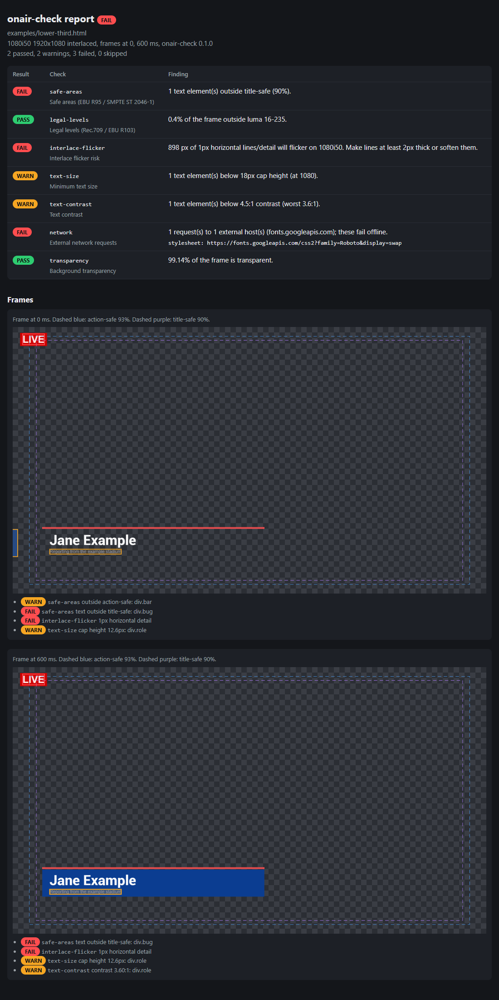

# onair-check

[](https://github.com/DDR83/onair-check/actions/workflows/ci.yml)

An on-air QA linter for HTML broadcast graphics. Point it at an overlay, lower third or scoreboard (any CasparCG, OBS or vMix browser source) and it tells you whether the graphic is safe to put on air.

> Status: v0.1 MVP. See [ROADMAP.md](ROADMAP.md) for what is planned.

## Who it is for

Graphics developers, broadcast engineers and streaming producers who ship HTML templates and want a repeatable check, locally or in CI, instead of discovering problems on air.

## What it checks

| Check | What it looks at |
| --- | --- |
| `safe-areas` | Visible elements outside action-safe (93%) and title-safe (90%), per EBU R95 and SMPTE ST 2046-1 |
| `legal-levels` | Pixels outside the Rec.709 legal range (luma 16-235 equivalent), with the EBU R103 tolerance, as % of the frame |
| `interlace-flicker` | 1px horizontal lines and fine horizontal detail that twitter on interlaced formats |
| `text-size` | Cap height of rendered text, normalised to 1080 lines |
| `text-contrast` | Contrast ratio of text against what is rendered behind it |
| `network` | Requests to the internet (fonts, scripts, images) that fail on an offline playout machine |
| `transparency` | The background is really transparent when it should be |

Each check reports `pass`, `warn` or `fail`, per captured time. Exit code is `0` for pass/warn, `1` for any fail, `2` for usage errors. `--strict` turns warnings into failures.

## Built with

Node.js 18+ and a single dependency, [`playwright-core`](https://playwright.dev/) (no browser download). It drives a Chrome or Edge that is already installed. The browser is found automatically, or set `CHROME_PATH`.

## Run

```bash
npm install
node bin/onair-check.js lower-third.html --format 1080i50 --at 0,500,end --html report.html
node bin/onair-check.js http://localhost:8080/overlay.html --json
```

```
onair-check <url|file> [--format 1080p50|1080i50|2160p50] [--at 0,500,end]
                       [--json] [--html <file>] [--strict] [--opaque]
```

- `--at` times in ms at which to capture. `end` is the end of the longest finite animation. Default `0,end`. Animations are stepped through `document.getAnimations()` (Web Animations, which also covers CSS animations and transitions); pages without any use real time.
- `--opaque` the graphic is expected to have an opaque background (skips the transparency failure).

## Example

A deliberately flawed synthetic lower third, [`examples/lower-third.html`](examples/lower-third.html), checked as 1080i50:

```bash
node bin/onair-check.js examples/lower-third.html --format 1080i50 --at 0,end --html report.html
```

```
onair-check 0.1.0  examples/lower-third.html
1080i50 1920x1080 interlaced  frames at 0, 600 ms

FAIL  safe-areas         1 text element(s) outside title-safe (90%).
      @0ms text outside title-safe: div.bug [40,28 89x44]
      @600ms text outside title-safe: div.bug [40,28 89x44]
PASS  legal-levels       0.4% of the frame outside luma 16-235.
FAIL  interlace-flicker  898 px of 1px horizontal lines/detail will flicker on 1080i50. Make lines at least 2px thick or soften them.
      @0ms 1px horizontal detail [121,812 898x1]
      @600ms 1px horizontal detail [121,812 898x1]
WARN  text-size          1 text element(s) below 18px cap height (at 1080).
      @0ms cap height 12.6px: div.role [150,900 290x20]
      @600ms cap height 12.6px: div.role [150,900 290x20]
WARN  text-contrast      1 text element(s) below 4.5:1 contrast (worst 3.6:1).
      @600ms contrast 3.60:1: div.role [150,900 290x20]
FAIL  network            1 request(s) to 1 external host(s) (fonts.googleapis.com); these fail offline.
      stylesheet: https://fonts.googleapis.com/css2?family=Roboto&display=swap
PASS  transparency       99.14% of the frame is transparent.

FAIL: 2 passed, 2 warnings, 3 failed, 0 skipped
```

The exit code is 1. The HTML report (frames over a checkerboard, safe areas dashed, findings boxed) looks like this:



`--json` prints the same result as machine-readable JSON (`status`, `summary`, and per check `frames[].metrics` and `regions`).

## Tests

```bash
npm test
```

Tests render tiny synthetic pages in `test/fixtures/`. They need Chrome or Edge and are skipped when none is found.

## Limits

Heuristics, not certification. Thresholds follow the cited recommendations where they exist; text size and contrast limits are practical defaults. Final sign-off belongs to a waveform monitor on the actual chain.

## Licence

Apache License 2.0. Copyright 2026 Didier Naim Defli.
